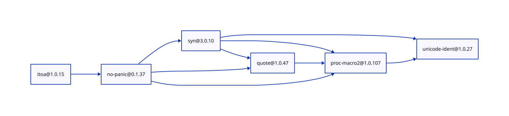
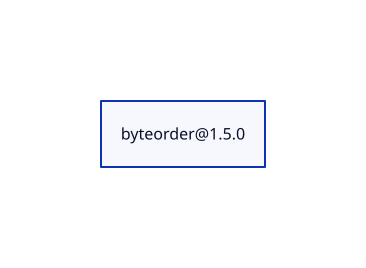
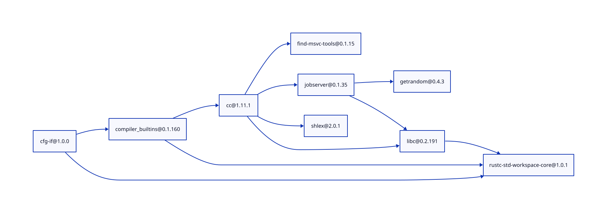

# Cargo Graph: практическая работа №2, вариант 33

**Автор:** Торопчанин Данил Егорович. **Группа:** УНБО-04-25.
Дисциплина: «Конфигурационное управление», РТУ МИРЭА, 2026.

## 1. Общее описание

CLI-инструмент строит граф зависимостей пакетов Rust/Cargo и выводит
его описание на языке D2. Реализация: Python 3.11 или новее, только
стандартная библиотека. Получение зависимостей выполняется собственным
кодом: HTTP-загрузка sparse-index, разбор JSON, выбор совместимых версий.
Менеджеры пакетов и сторонние библиотеки для получения зависимостей
в приложении не используются.

Реализованы все пять этапов варианта 33: INI-конфигурация, прямые
зависимости, рекурсивный BFS, обратные зависимости, D2.

## 2. Установка и запуск

Сборка и установка зависимостей не требуются. Нужен Python 3.11+.

```sh
git clone https://github.com/dt200702-sketch/cargo-graph-33.git
cd cargo-graph-33
./run.sh examples/test.ini
make test
```

Альтернативный запуск (в том числе на Windows PowerShell):

```powershell
$env:PYTHONPATH="src"
python -m cargo_graph examples/test.ini
python -m unittest discover -s tests -v
```

`make check` запускает тесты и проверку компиляции Python.
`make demo` выводит D2 тестового графа. Скрипт `run.sh` работает
из любой текущей папки; переданный путь INI относится к текущей папке.

Если Python на macOS сообщает `CERTIFICATE_VERIFY_FAILED`, установите
сертификаты штатным скриптом вашего дистрибутива Python. Для использованного
компьютера также проверен запуск с системным хранилищем сертификатов:

```sh
SSL_CERT_FILE=/etc/ssl/cert.pem ./run.sh examples/itoa.ini
```

Проверка TLS не отключается.

## 3. Конфигурация INI

Все параметры анализа задаются в одной секции `[graph]`.
Все шесть ключей обязательны, неизвестные ключи и секции отклоняются.

```ini
[graph]
package = itoa
repository = https://index.crates.io
test_mode = false
version = 1.0.15
max_depth = 4
exclude =
```

| Параметр | Назначение и проверка |
| --- | --- |
| `package` | Имя Cargo-пакета, 1–64 ASCII-символа; начинается с буквы |
| `repository` | HTTP(S) URL корня sparse-index или путь JSON в тестовом режиме |
| `test_mode` | `true/false`, также стандартные INI `yes/no`, `on/off`, `1/0` |
| `version` | Точная стабильная версия `X.Y.Z`, не `latest` и не диапазон |
| `max_depth` | Целое от 0 до 200, корень имеет глубину 0 |
| `exclude` | Регистрозависимая подстрока исключения; пустая отключает фильтр |

В тестовом режиме имена состоят из заглавных латинских букв.
Путь JSON разрешается относительно INI. Версия проверяется синтаксически,
но тестовый граф не содержит версий. Пробелы по краям значений удаляются.
Если фильтр совпал с именем корня, результат — пустой граф.
Исключённые зависимости не загружаются и не разворачиваются.

## 4. Режимы работы

CLI задаёт только операцию; параметры анализа остаются в INI.

| Команда | Результат |
| --- | --- |
| `./run.sh examples/test.ini --mode config` | Все настройки в формате ключ=значение (этап 1) |
| `./run.sh examples/itoa.ini --mode direct` | Прямые зависимости выбранной версии (этап 2) |
| `./run.sh examples/test.ini --mode graph` | JSON: граф и минимальные расстояния (этап 3) |
| `./run.sh examples/test.ini --mode reverse --target D` | Транзитивные обратные зависимости D (этап 4) |
| `./run.sh examples/test.ini --mode d2` | D2-описание (этап 5, режим по умолчанию) |

`--target` используется в режиме `reverse`. В тестах это имя `D`,
в реальном графе — `name@version`. Если цель не задана, используется корень.
Успех: код завершения 0; ошибка: код 2 и сообщение `Error: ...` в stderr.
Данные поступают в stdout, поэтому их можно перенаправить в файл.

## 5. Рекурсивный BFS и обратные зависимости

Каждый рекурсивный вызов обрабатывает **целый уровень** графа, затем
передаёт следующий фронт рекурсивному вызову. Узлы отмечаются при
обнаружении, а не после раскрытия. Поэтому расстояния минимальны,
ромбы не приводят к повторной обработке, циклы и петли не зацикливают обход.
Число рекурсивных вызовов зависит от глубины, а не ширины графа.
Предел 200 защищает обычный стек Python.

Узлы на границе `max_depth` присутствуют, но их зависимости не запрашиваются.
Оценка обхода без сортировок и сети: O(V + E), память O(V + E), стек O(depth).
Сортировка соседей обеспечивает стабильный порядок вывода.

Для обратного обхода рёбра инвертируются, затем используется **тот же BFS**.
Ответ содержит расстояние от цели в обратном графе. Сама цель в ответ
не включается даже при циклах.

**Область поиска:** в тестовом режиме используется весь JSON-репозиторий,
включая узлы, недостижимые из корня. В сетевом режиме используется только
построенный граф корня в пределах глубины: приложение не скачивает весь
crates.io и не заявляет поиск всех пользователей пакета в реестре.

## 6. Тестовый репозиторий и примеры

`examples/repository.json`:

```json
{"A": ["B", "C"], "B": ["D"], "C": ["D"], "D": ["A"], "E": []}
```

Все упомянутые узлы должны быть объявлены. Повторы рёбер удаляются.
Здесь есть ромб A–B/C–D, цикл D–A и изолированный узел E.

```sh
./run.sh examples/test.ini --mode graph
./run.sh examples/test.ini --mode reverse --target D
./run.sh examples/test.ini --mode reverse --target E
```

Порядок раскрытия: A, B, C, D; расстояния: A=0, B=1, C=1, D=2.
Обратные зависимости D: B=1, C=1, A=2. Для E результат `{}`.
При `max_depth = 0` остаётся A без рёбер, при 1 — A→B и A→C.
При `exclude = C` остаются A→B→D→A. Эти случаи проверяются тестами.

Для демонстрации ошибок измените любой ключ в копии INI:
`package = ../bad`, `repository = file://bad`, `test_mode = perhaps`,
`version = latest`, `max_depth = -1` или неизвестный ключ вместо `exclude`.
Контрольные символы в фильтре также отклоняются. Тесты покрывают ошибки
всех параметров, неизвестные версии, некорректный JSON и сетевые ошибки.

## 7. Три реальных пакета и D2

Проверено 10.11.2026. Исходные D2 и результаты `cargo tree`
сохранены в `docs/examples/`. SVG созданы внешним D2 0.9.0;
D2 нужен только для дополнительного просмотра, не для анализа.

```sh
./run.sh examples/itoa.ini > itoa.d2
d2 itoa.d2 itoa.svg
./run.sh examples/byteorder.ini > byteorder.d2
d2 byteorder.d2 byteorder.svg
./run.sh examples/cfg-if.ini > cfg-if.d2
d2 cfg-if.d2 cfg-if.svg
```

### itoa 1.0.15



6 узлов, 9 рёбер при глубине 4. Включён необязательный `no-panic`,
далее — его proc-macro-зависимости.

### byteorder 1.5.0



1 узел, 0 рёбер: обычных и сборочных зависимостей нет.

### cfg-if 1.0.0



9 узлов, 11 рёбер при глубине 4. Включены необязательные зависимости
для сборки стандартной библиотеки Rust и их транзитивные зависимости.
Узлы на глубине 4 являются границей анализа, а не обязательно листьями реестра.

## 8. Сравнение с Cargo

Реально выполнено `cargo tree --prefix none` (Cargo 1.98.1, macOS ARM64)
для трёх отдельных минимальных проектов с точными зависимостями
`itoa = "=1.0.15"`, `byteorder = "=1.5.0"`, `cfg-if = "=1.0.0"`.
Cargo используется только для внешней проверки; приложение его не запускает.
Файлы `docs/examples/*-cargo.txt` содержат результаты.

| Корень | Наш граф, узлов | Cargo, узлов без проекта-обёртки | Причина |
| --- | ---: | ---: | --- |
| itoa 1.0.15 | 6 | 1 | Cargo не включает необязательный `no-panic` по умолчанию |
| byteorder 1.5.0 | 1 | 1 | Результаты совпадают |
| cfg-if 1.0.0 | 9 | 1 | Cargo не активирует необязательные зависимости std |

Наш инструмент показывает **граф объявленных normal/build-зависимостей**:
все optional и все target-платформы включены, `dev` исключены.
Он не воспроизводит разрешение features и общий lockfile Cargo.
Для каждой зависимости выбирается самая новая подходящая стабильная
неотозванная версия; один пакет может присутствовать в нескольких версиях.
Поэтому версии, размеры и рёбра могут отличаться от конкретной сборки.
После обновления реестра результат может измениться; сохранённые диаграммы
фиксируют выполненную демонстрацию.

Поддержаны Cargo-диапазоны `^`, `~`, `*`, `1.*`, `1.2.*`, `=`, `<`, `<=`,
`>`, `>=` и пересечение через запятую. Голая версия означает caret.
Ограничения: prerelease-требования и зависимости из других реестров
отклоняются явно. Не реализован SAT-решатель Cargo и учёт MSRV.
Точная корневая версия может быть yanked; транзитивные yanked пропускаются.

## 9. Структура и история

```text
src/cargo_graph/  конфигурация, версии, реестр, BFS, D2, CLI
tests/           автономные тесты unittest
examples/        INI и тестовый JSON
docs/examples/   D2, SVG и результаты сравнения
run.sh           переносимый POSIX-запуск
Makefile         test, check, demo
.gitignore       исключение временных и служебных файлов
```

Этапы зафиксированы отдельными Conventional/Scoped Commits:
`feat(config)`, `feat(registry)`, `feat(graph)`, `feat(reverse)`, `feat(render)`.
Последующие коммиты содержат проверку качества и документацию.
История реальная: коммиты создавались после реализации соответствующих этапов.

## 10. Функции и классы


### __main__.py

- `execute` — Dispatch configuration, direct dependency and graph operations.
- `main` — Run an operation; return 2 for invalid input or unavailable data.

### config.py

- `Config` — Validated settings; repository paths are relative to the INI file.
- `validate` — Reject unsupported values before any network operation.
- `validate_repository` — Validate the selected source without fetching remote resources.
- `load_config` — Read exactly six settings from the [graph] section.

### graph.py

- `TestRepository` — Strict uppercase adjacency-list fixture, version-independent.
- `TestRepository.dependencies` — Return filtered children, rejecting an unknown starting node.
- `build_graph` — Return adjacency and minimum distances using recursive BFS.
- `reverse_dependencies` — Traverse transitive dependents with the same recursive BFS.

### registry.py

- `index_path` — Compute the path mandated by the Cargo sparse-index format.
- `Registry` — Cache records; include all declared normal/build dependencies.
- `Registry.records` — Fetch raw newline-delimited JSON without a package manager.
- `Registry.record` — Find the exact requested root/dependency version.
- `Registry.resolve` — Select the newest non-yanked stable matching version.
- `Registry.dependencies` — Resolve declared dependencies, filtering before network access.

### render.py

- `to_d2` — Encode labels as JSON strings and use safe synthetic D2 IDs.

### semver.py

- `version_tuple` — Parse a stable version; prereleases are deliberately unsupported.
- `upper_bound` — Return the exclusive upper bound for caret or tilde.
- `matches_clause` — Match one stable comparator, wildcard, caret or tilde clause.
- `satisfies` — Match comma-separated Cargo requirements for stable versions.
- `matches_wildcard` — Match a numeric prefix followed only by wildcard components.

## 11. Проверка и источники

`make test`: 24 теста, включая циклы, ромбы, широкий фронт из 1500 узлов,
глубину 0/1, фильтр, инверсию, SemVer, ошибки INI/JSON/сети и D2.
Тесты автономны и не требуют подключения к сети.

- Задание: сборник УНБО-04-25, вариант 33, страницы 104–106.
- [Cargo Registry Index](https://doc.rust-lang.org/cargo/reference/registry-index.html).
- [Cargo Version Requirements](https://doc.rust-lang.org/cargo/reference/specifying-dependencies.html).
- [D2](https://d2lang.com/).

Для СДО: публичный URL репозитория и PDF этого README, сохранённый
из браузера. PDF хранится отдельно от репозитория, чтобы не добавлять
бинарные артефакты в исходный код. Для защиты следует уметь объяснить
обход по уровням, минимальные расстояния, область обратного поиска
и отличие объявленных зависимостей от дерева конкретной сборки Cargo.
